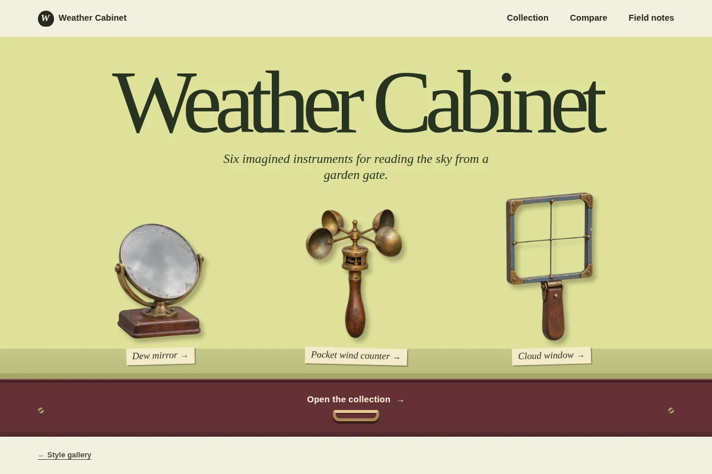

# Design With Character

A creative website skill for **ChatGPT Work and Codex**. Start from something a visitor can do. Build the opening, what happens next, and the routes people use when they come back. Choose one of five working styles or develop a direction from the material in your own project.

**Download the repository, extract it, and open `index.html`.** The gallery lets you compare each style before and after its main action on a desktop and a phone. The five demos run offline as individual HTML files. The Weather Cabinet uses multiple files; keep the extracted folder together.

| Go here | To do this |
|---|---|
| [Style gallery](index.html) | Compare opening and changed states, then try the working example. |
| [The Weather Cabinet](weather/index.html) | Browse six fictional instruments, compare two and keep your own field notes across an 11-page site. |
| [Use it in ChatGPT Work](docs/use-in-work.md) | Start a new project, revise an existing site, or hand the work to the next conversation. |
| [Portable skill](skills/design-with-character/SKILL.md) | Read the method or copy the skill to your own project. |
| [Add a style](CONTRIBUTING.md) | Build an unpublished draft and promote it after testing its real interaction and previews. |

GitHub’s file viewer displays HTML as source. To use the demos, open your extracted copy in a browser or serve the repository as a static site.

[](weather/index.html)

## Five styles you can actually use

| Style | First action | A change you can see |
|---|---|---|
| [Halftone Dossier](halftone-dossier.html) | Open Pip's case file and read three pieces of evidence. | File the report and the stamp becomes part of the record. |
| [Botanical Letterpress](botanical-letterpress.html) | Pull the cobalt tab on a pressed cosmos folio. | The paper opens into the field note kept with the flower. |
| [Specimen Cabinet](specimen-cabinet.html) | Open the rain, wind or sun drawer. | Inspect an instrument and keep it in your field notes. |
| [Arcade Workshop](arcade-workshop.html) | Play the eight-step drum machine and change a pad. | The playhead, pad and audible pattern respond to the edit. |
| [Pixel Study Room](pixel-study-room.html) | Start a focus session with Mallow. | The desk lamp and companion respond to the timer. |

The [full Weather Cabinet](docs/weather-cabinet.md) expands the third study into distinct places for arrival, finding, close inspection, comparison, writing and recovery. Its six instrument detail pages share a layout because they do the same job. The compare surface and the notebook have different jobs and different arrangements.

## Use it on a real website

In ChatGPT Work, select the installed **Design With Character** skill or provide this repository and tell Work to read the portable skill. For example:

> Use Design With Character on our community radio site. A first-time visitor wants to hear what's on now. A regular wants to find the episode they missed. Keep our player and archive URLs. Show me those two paths on mobile, including an episode whose recording is missing.

The skill can propose a fresh direction; the catalog is an option, not a prerequisite. It includes an example based entirely on a dance rehearsal timeline. For a team using local Codex, copy the whole `skills/design-with-character` folder into the target repository's `.agents/skills/` directory. Preserve the reference files alongside the entry point. [Codex skill discovery](https://developers.openai.com/codex/skills/).

To test live pages in another local project, point the route runner at its plan and preview server. For example, with the Weather Cabinet server running, use this command:

```sh
python scripts/visit_project.py --project examples/weather-project --base-url http://127.0.0.1:8000/weather/
```

For larger sites, see [route families and return visits](docs/scale-a-site.md), the [executable Weather Cabinet plan](examples/weather-project/site-plan.json), and [how to turn a reference into a decision](docs/reference-method.md). The kit includes optional project-local design history, art direction for GPT Image, and four passes for testing a release.

## Run, rebuild and check

Opening the gallery requires a browser. For consistent note storage between Weather Cabinet pages, serve the extracted repository from one local origin. From the repository root run:

```sh
python scripts/serve.py --port 8000
```

Then open [the local gallery](http://127.0.0.1:8000/) or [the local Weather Cabinet](http://127.0.0.1:8000/weather/). Field notes belong to the current browser and origin. Export a backup from the notes page when moving between them.

Use Python 3.12 for the full authoring and browser-test workflow. The build and project-planning tools alone run on Python 3.10 or later. Rebuild after editing a source file and run the release checks:

```sh
python scripts/build.py
python weather/build.py
python scripts/check.py
python scripts/test_checks.py
python scripts/test_project.py
python scripts/project.py --project examples/weather-project check --site weather
python -m pip install -r scripts/browser-requirements.txt
python -m playwright install chromium
python scripts/check_browser.py
python scripts/test_contribution.py
python scripts/test_visit_project.py
```

Use a Python virtual environment for the browser test runner. On Linux CI, install Chromium's system libraries with `python -m playwright install --with-deps chromium`. The [checks guide](docs/checking-the-release.md) describes the tested behavior and the judgments that need a reader. The [GitHub Actions workflow](.github/workflows/check.yml) runs on pushes and pull requests. To block merging on failure, make its **release-checks** job a required status check in your repository's branch rules after its first run. [GitHub branch protection](https://docs.github.com/en/repositories/configuring-branches-and-merges-in-your-repository/managing-protected-branches/about-protected-branches).

## Make a single-file preview

Run `python gallery-assets/export_lookbook.py ../Design-With-Character-Preview.html` to make a portable preview you can send without the source. It includes the cabinet and the opening and changed frames of all published styles with captures. The reader can switch devices, inspect the frames at their original size and open the file offline. The working demos stay in the repository.

## Publishing the ZIP to GitHub

Extract the ZIP into the folder you intend to push. You should see `README.md`, `index.html`, `.github/`, `skills/`, `styles/` and `weather/` directly inside that folder. If your extraction tool creates a folder named after the ZIP, use that extracted folder as the repository root. Include dotfiles when moving its contents. To publish the website separately, serve the root as static files; the gallery and demos use relative links. The root 404 template is for GitHub Pages branch builds. The [Weather Cabinet guide](weather/README.md) explains how local and other hosts handle missing pages.

Original software and tooling use the [MIT License](LICENSE). The [credits](REFERENCES.md) identify the passages adapted under CC BY 4.0 and the source revisions that informed this project. Check the [media register](credits/assets.json) for each asset's origin and terms.
