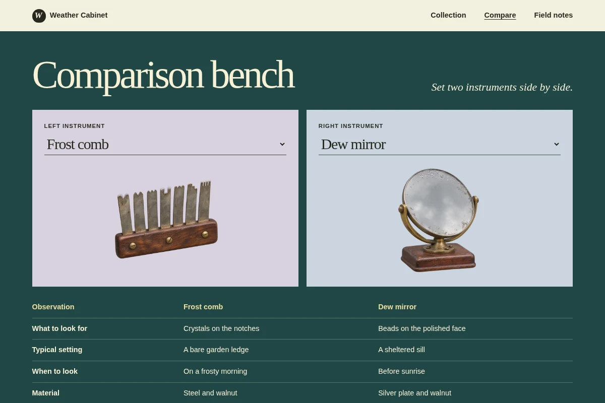

# The Weather Cabinet, from one drawer to a whole site

The small [Specimen Cabinet](../specimen-cabinet.html) asks one question: what is behind this drawer? Its native disclosures and compact saved list serve that question. The [full Weather Cabinet](../weather/index.html) gives people six instruments to search, compare and annotate. A visitor can enter directly at a particular instrument and leave with a note of their own.

## Three ways to visit

| Try it | What to look for |
|---|---|
| [Enter the cabinet](../weather/index.html), browse the inventory, then open an instrument. | The entrance introduces the collection through scale and material. The collection lets the names and instruments do more of the work. |
| [Open a comparison directly](../weather/compare.html?a=rain-catcher&b=folding-sundial). Change one instrument. | A stable comparison surface preserves orientation while the object changes. A visitor can skip the entrance entirely. |
| [Inspect the rain catcher](../weather/objects/rain-catcher.html), write an observation, then visit [field notes](../weather/notes.html). | The object view gives the instrument room. Once the visitor has written something, their own words deserve priority in the notes view. |

Try an empty search, an invalid notes import, a narrow viewport and the [recovery page](../weather/404.html). These are places where a broad design system usually reveals whether it can handle real use. The recovery file is directly navigable. Run `python scripts/serve.py --port 8000 --mount /garden` and visit `http://127.0.0.1:8000/garden/weather/objects/missing.html` to see the same view served at a genuinely missing address with HTTP status 404. Its collection link should take you back to the mounted site. The [hosting notes](../weather/README.md) cover the root template and other static hosts.

## What carries across the routes

Instrument identities, vocabulary, navigation and storage behavior should feel familiar wherever a visitor arrives. The hero composition and entrance motion serve the entrance. The comparison needs equal visual weight for two things. A notebook needs legible writing space. Using one visual arrangement across all three would make at least two jobs harder.

The six object pages deliberately share their reading and writing structure. That consistency makes moving from the wind counter to the dew mirror easier. When adding a seventh instrument, preserve that contract; a new specimen alone does not warrant a seventh detail layout. If a future instrument has a sound that visitors actually need to compare, revisit the comparison experience as a family.

## Take this into another project

Try the same method on a community film festival. A first visit might open on a screening already in progress; a returning attendee needs the next screening at their venue; a film page needs a synopsis, time and ticket link; an accessibility page needs a direct, legible answer. The scheduling and booking controls should retain the same meanings everywhere. A film strip treatment could work for one of those jobs and get in the way of the others.

The [working route plan](../examples/weather-project/site-plan.json) records six route families and five journeys. The [project commands](scale-a-site.md) validate its references and print the routes for a reviewer. For source, start with the [entrance HTML](../weather/index.html). To see how the contributor contracts fit together, read [CONTRIBUTING.md](../CONTRIBUTING.md).
